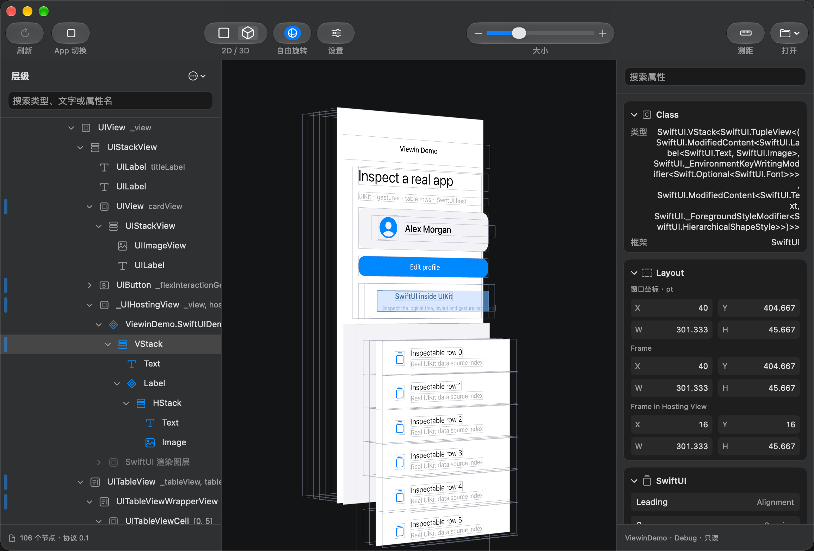

<p align="center">
  <a href="https://github.com/FeliksLv01/Viewin">
    
  </a>
</p>

<h1 align="center">Viewin</h1>

<p align="center">English · <a href="README.zh-CN.md">简体中文</a></p>

<p align="center"><strong>See inside your app’s hierarchy, layout, and properties.</strong></p>
<p align="center">A mobile UI inspector for developers and AI agents.</p>
<p align="center">UIKit · SwiftUI · Android View / XML · Jetpack Compose</p>

<p align="center">
  <a href="https://github.com/FeliksLv01/Viewin/releases">Downloads & Releases</a> ·
  <a href="#getting-started">Getting Started</a> ·
  <a href="#cli-and-agent-skill">CLI / Agent Skill</a> ·
  <a href="https://github.com/FeliksLv01/Viewin/issues">Report an Issue</a>
</p>

<p align="center">
  
</p>

<p align="center"><sub>A capture of a mixed UIKit and SwiftUI interface, with its hierarchy, 3D preview, and structured inspector.</sub></p>

> Viewin is in early development. The first installer has not been released yet. The mobile SDK is maintained separately and is not yet available through remote SwiftPM or Maven distribution. The sections below distinguish implemented features from capabilities that still need validation.

## Features

- **Explore the actual hierarchy**: a three-column interface with resizable hierarchy and inspector panels, search, focus, and node expansion and collapse.
- **Understand layout relationships**: 2D / 3D previews, free rotation, trackpad zoom, bounds and layer spacing settings, and synchronized selection between the hierarchy and preview.
- **Read structured properties**: geometry, visibility, colors, fonts, shadows, member references, list positions, and framework-specific property groups. Colors support RGBA / HEX.
- **Inspect events and gestures**: read captured recognizers, control events, Target / Action pairs, and semantic actions.
- **Measure distances**: select one layer and hover over another. Supports 2D / 3D, temporary measurement with Option, and a toolbar toggle to keep measurement enabled.
- **Save and share snapshots**: store the hierarchy, properties, and images in a single `.viewin` file, then open it without a device connection.
- **Give agents the same data**: discover apps, capture snapshots, or export JSON and images through the CLI, without opening the desktop app or requiring MCP.

The interface supports English and Simplified Chinese, following macOS system or per-app language preferences. Captured app text, type names, and property API names remain unchanged.

## Supported Frameworks

| Framework | Current capabilities | Limitations |
| --- | --- | --- |
| UIKit | View / Layer hierarchy, properties, screenshots, gestures, control events, and Table / Collection item positions | Explicitly enabled in Debug and internal Release builds; some system rendering effects cannot be fully reproduced |
| SwiftUI | Readable logical tree, recognized modifiers and static gestures, and rendering-layer associations | Currently adapted and tested on the iOS 27 simulator; Release capabilities depend on successful runtime reads, with a fallback to the host hierarchy |
| Android View / XML | View tree, layout parameters, resource IDs, state, screenshots, and RecyclerView / AdapterView positions | RecyclerView includes Adapter, LayoutManager, ViewHolder, and binding positions; XML file paths and line numbers are not provided |
| Jetpack Compose | Layout nodes, parameters, modifiers, and semantics in Debug | Internal Release can fall back to semantics; Lazy lists include only placed nodes; independent drawing-layer textures are not available yet |

**A 3D preview does not mean every logical node has its own image.** Only some successfully associated SwiftUI leaf nodes use actual CALayer textures. Other nodes and Compose may only provide a crop of the host’s composited image when a subtree is collapsed. Expanded logical containers show outlines without repeating the entire subtree image.

Snapshots record missing information, partial captures, and unsupported capabilities. SwiftUI private runtime changes, obfuscation, and framework versions may affect capture results.

## Getting Started

### 1. Install the desktop app

Viewin requires **macOS 15.6 or later**. Once the first installer is published, download it from [GitHub Releases](https://github.com/FeliksLv01/Viewin/releases) and move it to Applications.

### 2. Enable the SDK in your app

The desktop app and mobile SDK are separate repositories. This repository does not contain mobile capture code. The SDK currently integrates as a local Swift package or Gradle module; see the companion `ViewinSDK` repository for details.

**iOS**: add the `ViewinSDK` product and start it when your app launches. For SwiftUI inspection, start it before the first SwiftUI host is created.

```swift
import ViewinSDK

try Viewin.start()
// Viewin.stop()
```

The SDK requires iOS 15 or later. Declare the build type with `buildType: .debug` or `.internalRelease`. This is diagnostic information, not a guarantee that a capture capability is available. The host app explicitly decides whether to integrate and enable the SDK in both Debug and internal Release builds.

**Android**: start the SDK in `Application.onCreate`. View-based apps depend on `viewin-sdk`. Compose apps use the optional `viewin-compose` module, which includes the base SDK, and start it before the first `setContent` call.

```kotlin
Viewin.start(
    this,
    buildType = if (BuildConfig.DEBUG) Viewin.BuildType.DEBUG
                else Viewin.BuildType.INTERNAL_RELEASE
)
// Viewin.stop()
```

Android API 29 or later is required. The current Compose integration targets UI / tooling-data 1.10.6; other versions need further validation.

### 3. Connect and inspect

Keep the target app in the foreground and open Viewin. The start screen shows discovered apps. A single app is captured automatically; with multiple apps, click a preview to enter. Switch apps from the toolbar or open a saved snapshot at any time.

| Connection | Current status |
| --- | --- |
| iOS simulator | Verified; direct local connection to the SDK |
| Android emulator | Verified; automatic discovery and ADB forwarding |
| Android device over USB | Implemented; requires USB debugging authorization; physical-device testing is pending |
| iOS device over USB | Planned |
| Wireless discovery and pairing | Planned |

By default, the SDK listens only on `127.0.0.1:48721`. For Android, start the local ADB server through Android Studio or `adb start-server` first. Viewin communicates directly with the ADB server to discover devices and establish forwarding on demand, without launching an external ADB process.

If your app does not appear, confirm that the SDK is running, the app is in the foreground, and Android’s ADB server and device authorization are ready, then refresh discovery.

## CLI and Agent Skill

The desktop app includes a CLI. Open **Settings → Agent** to install or update the `viewin` skill and copy CLI commands. With the skill installed, agents can inspect apps without opening Viewin.

- The default directory is `~/.agents/skills/viewin`. You can also choose the Codex, Claude Code, OpenCode, or Pi directory, or a custom location.
- The first installation uses the system folder picker to authorize access. A security-scoped bookmark is saved for later updates.
- Installation does not change agent MCP or permission settings, or overwrite a same-name skill from another source.
- The launcher uses the full path to the bundled CLI. No Swift / Xcode installation or PATH configuration is required.
- After moving the desktop app, update the skill in Settings. If an agent does not discover it, start a new session or restart the agent.

These examples assume Viewin is installed at `/Applications/Viewin.app`:

```sh
# List available apps, including ports, app names, and devices
"/Applications/Viewin.app/Contents/Helpers/viewin" --list

# Capture a specific target into a single snapshot file
"/Applications/Viewin.app/Contents/Helpers/viewin" \
  --port 48721 --output capture.viewin

# Export snapshot.json and an images/ directory for agent analysis
"/Applications/Viewin.app/Contents/Helpers/viewin" \
  --port 48721 --format json --output capture-data
```

Android targets in `--list` may use automatically assigned local ADB forwarding ports; use the actual port shown. Without `--port`, capture uses the first discovered target. Specify a port when multiple apps are available.

The CLI currently supports discovery and capture. It does not tap controls, execute gestures, or modify runtime properties.

## Snapshot Format

A `.viewin` file is a ZIP archive containing:

```text
capture.viewin
├── manifest.json        # Format version and image path mappings
├── snapshot.json        # Hierarchy, geometry, properties, capabilities, and capture status
└── images/              # Images deduplicated by content
```

JSON is compressed; PNG images are stored without additional compression and deduplicated by content. The CLI’s JSON export mode writes a directly readable directory. The desktop app can also read older `.inview` / `.uiinspector` snapshots.

## App Updates

Release builds use [Sparkle 2](https://sparkle-project.org/) to check for, download, and install updates hosted on this repository’s GitHub Releases.

- Choose “Check for Updates…” from the app menu, or enable automatic checks in Settings.
- Automatic checks are off by default. When enabled, Sparkle handles scheduling without an additional polling loop.
- The update feed is the latest stable release’s `appcast.xml`; downloads point to a specific release archive.
- Updates are verified with EdDSA signatures. The private key stays in the publisher’s local Keychain and is not committed to the repository.
- Debug builds disable self-updates to avoid being replaced by a release build.

**The online update feed is unavailable until the first release is published.** Successful local builds do not constitute verification of downloading, replacing, and relaunching an installed app.

## References and Dependencies

Interaction and capture approaches draw inspiration from [Lookin](https://github.com/QMUI/Lookin), [LookInside](https://github.com/LookInsideApp/LookInside), and [CodeLocator](https://github.com/bytedance/CodeLocator). Viewin uses an independent SDK and protocol and does not embed these projects’ runtime code.

Desktop dependencies are [Sparkle](https://github.com/sparkle-project/Sparkle) and [ZIPFoundation](https://github.com/weichsel/ZIPFoundation).
